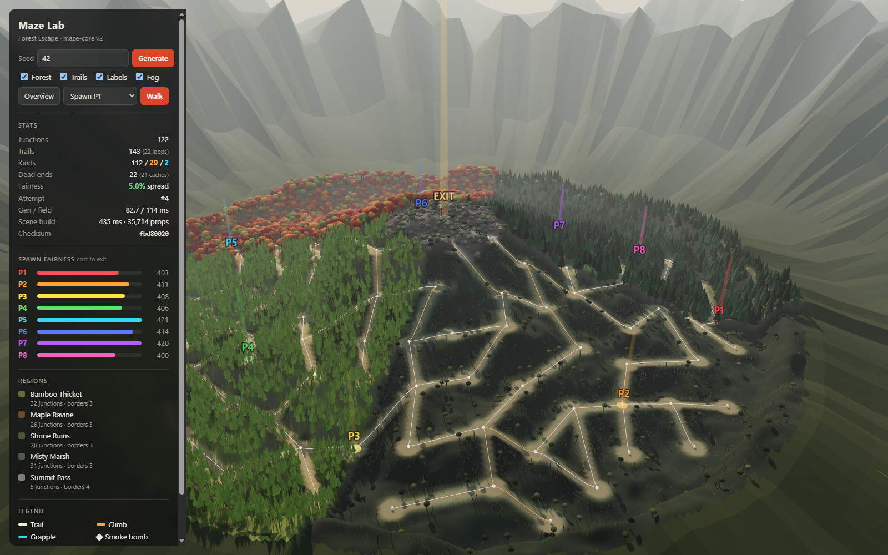

# Forest Escape PvP

An 8-player race up a forested mountain. Every match is a new procedural maze of trails through bamboo, maple ravines, cedar shrines and bog. The exit gate on the summit is always visible; the route to it never is. First to reach it wins. Stealth, traversal (climb / grapple) and combat decide the race, and killing an opponent reveals part of the map.

> **Status:** Phase 0–1 complete (maze generator v2). Phase 2 environment in progress: procedural sky/weather/wind/foliage/soil, Rapier physics, first-person hands, procedural audio.
> Stack: TypeScript · three.js · Rapier · Vite · Vitest (Node 24). Server (Phase 5) will be Node, sharing `maze-core`.



## Quick start

```bash
npm install
npm run dev          # Maze Lab at http://localhost:5173
npm run host         # Build and host a 6-player LAN match on port 3000
npm test             # 26 tests over 60 seeds
npm run typecheck
npm run maze -- 42 7 # print stats for seeds
npm run survey       # tune: stats over 300 seeds
```

**URL options:** `?seed=42` · `?cam=p1`..`p8` (stand at a spawn) · `?time=5..19` · `?weather=clear|overcast|mist|rain|storm` · `?auto=1` (weather cycles) · `?quality=low`

**Walk controls:** WASD move · Shift run · Space jump · C crouch · Click throw a stone · **V switch first/third person** · Esc pause (click to resume)

## Play a local multiplayer match

1. On the host laptop, run `npm run host` from this project folder. The command builds the game and starts one central game server on port 3000.
2. Open `http://localhost:3000` on the host laptop. The terminal prints its Wi-Fi/hotspot address, for example `http://192.168.1.24:3000`.
3. The host clicks **Create room** and shares that address and the five-character room code with up to five other players.
4. Everyone must be on the same Wi-Fi or hotspot. They open the host's address in a modern desktop browser and enter the room code. The six-seat lobby shows who joined; each connected player clicks **I'm ready**, and the host starts when at least two players are connected and ready.

The host laptop must stay on and connected. Allow Node.js through the host computer's firewall on **Private networks** if Windows asks. Some phone hotspots isolate connected devices; if players cannot open the host address, use a Wi-Fi router or a hotspot that allows devices to communicate. Internet access is not needed for a LAN match.

The server assigns unique spawns, checks submitted positions against the generated maze's walkable field and movement limits, tracks distance and regions, decides who reached the exit first, and broadcasts the shared player state. A dropped player can reconnect for 60 seconds; the browser remembers their room session. Finished match summaries are appended to `apps/server/data/matches.jsonl` on the host. This first multiplayer version relays validated player state; full server-side physics simulation and protection against modified clients remain future work.

## Layout

```
packages/maze-core/      engine-agnostic, deterministic generator (runs on server + client)
  src/rng.ts             sfc32 PRNG + hashing (never use Math.random in core)
  src/noise.ts           seeded value noise / fbm
  src/terrain.ts         base mountain height function
  src/generator.ts       maze pipeline (see below)
  src/field.ts           walkability + height grid (collision & rendering)
  src/graph.ts           Dijkstra, BFS, union-find, heap
  src/checksum.ts        maze checksum for client/server agreement
  test/                  vitest suite
  scripts/               print-maze, survey
apps/viewer/src/         three.js "Maze Lab"
  main.ts                game loop: modes, input, physics step, render
  world.ts               assembles terrain, forest, horizon, exit gate, markers, debug overlay
  ui.ts                  side panel (seed, environment, stats, fairness)
  audio.ts               procedural Web Audio: wind, rain, birds, thunder, footsteps, impacts
  lab.ts (+ lab.html)    Asset Lab: cheap close-up scene for reviewing grass, leaves and hands
  env/textures.ts        procedural tileable textures (soil layers, bark, leaf cards, leaf atlas)
  env/leafArt.ts         botanical leaf painters: palmate maple, ovate broadleaf, bamboo lance
  env/terrain.ts         5-layer height-blended soil shader, wetness, puddles, bog water
  env/foliage.ts         maple/cedar/bamboo/dead trees, rocks, lanterns (chunked instancing)
  env/grass.ts           GPU grass + reeds: real blade geometry around the player, driven by the walk field
  env/ferns.ts           GPU bracken ferns (orange in the ravine, green in the shrine forest)
  env/cascade.ts         the ravine waterfall landmark: stone steps, falling water, pool, spray, sound
  env/post.ts            cinematic pipeline: height mist + sun glow, light shafts, bloom, colour grade
  env/ambience.ts        per-biome mood (mist, shafts, dust) and the golden-hour sun alignment
  env/motes.ts           dust motes glowing in the sun shafts
  env/shared.ts          shared env uniforms + wind-bend shader patch
  env/sky.ts             sun path, sky, clouds, fog colour, sky lighting (PMREM), lightning
  env/weather.ts         weather presets, transitions, auto cycle, wetness, lightning timing
  env/rain.ts, leaves.ts GPU rain streaks + splashes, falling leaves
  player/physics.ts      Rapier world: terrain heightfield, trunk/rock colliders, props, stones
  player/controller.ts   first-person character controller
  player/hands.ts        first-person hands view model + animation
  player/character.ts    third-person explorer (procedural model + procedural animation)
  turnaround.ts (+ .html) character sheet: the explorer in A-pose, 4 views
  hud.ts                 compass map of explored trails, stamina/tools/noise icons, camera hint
docs/                    plan + design notes
```

## Environment & player (viewer)

Everything is procedural: no downloaded art or sound files.

- **Sky & sun:** physically based sky with a sun path from 05:00 to 19:00, golden hour, and shadows that follow the player. The sky lights the scene through PMREM image-based lighting.
- **Weather:** clear, overcast, mist, rain and storm. Presets blend smoothly. Rain builds up ground wetness, which then dries slowly. Storms bring lightning, with thunder delayed by distance.
- **Wind:** gust fronts travel across the map. Trees, bamboo, grass, cloud drift, rain slant and leaf fall all follow the wind.
- **Soil:** moss, trail dirt, rock (triplanar on cliffs), leaf litter and mud, blended by height. Wet ground goes darker and glossier, and puddles show rain ripples.
- **Physics (Rapier):** the terrain heightfield is built from the walk field. Trees, rocks, the torii and cache plinths are colliders. Loose rocks and logs can be pushed, and thrown stones bounce and roll.
- **Character:** acceleration and friction, gravity, jump, sprint and crouch. Slopes are limited to 48°. Wet and muddy ground slows you or makes you slip. Footstep sounds change with the surface.
- **Grass:** real curved blades rather than alpha cards. They grow in a world-anchored field around the player, read the walk field for density, and blend from ground-coloured roots to the tips. The trail centre stays bare, trampled edges are short, and marsh banks get reeds. Blades bend in gusts and part around the player.
- **Leaves:** botanical leaf shapes with serrated edges and veins, used in both the canopy cards and the falling leaves. Falling leaves are cupped and glide side to side like real ones.
- **Hands:** a procedural view model at real adult proportions: shaped palm, knuckles, tapered fingers with nails, and a three-bone thumb, in a skin-sheen material. It animates for idle, walk, run, jump and land, sways with mouse look, and has a stone-throw animation.

**Maple Ravine showcase (P6, seed 42):** the default time is golden hour (17:18), and the sun path is rotated so it sets down the ravine spawn's first trail. You walk into backlit mist and light shafts between tall dark trunks with golden canopies and low red maples. The ground is an orange leaf carpet with bracken ferns, mossy pink granite boulders sit along the trail, and a stepped waterfall falls into a pool beside the path (with positional water sound). The **Cinematic** toggle in the panel switches the mist, light shafts, bloom and grading on or off.

**Mountain pine forest (Shrine region; P1/P7/P8 on seed 42):** tall ponderosa and lodgepole pines with plated bark, branch whorls carrying needle tufts, and dead lower stubs. A dusty trail runs between 3 m mossy banks, with low shrubs, ferns and wild grass along it and grey lichen-covered granite boulders. Blue valley mist fills the low ground. A snow-capped granite range surrounds the whole map. The player wears worn leather gloves with rope-wrapped wrists.

**Third person & HUD:** the default view is over the shoulder. The camera sits behind the explorer's right shoulder and pulls in when trees or banks are in the way, and V switches to first person. The explorer is an original procedural character (male, about 30, lean build): a weathered stubbled face, short dark hair, wide-brim dark-brown felt hat, olive field jacket open over a cream henley, leather chest strap with a pouch, backpack with bedroll and coiled rope, rope-wrapped leather gloves, a hatchet on the belt, dark canvas trousers and brown hiking boots. The character is animated for walking, running, crouching, jumping and throwing. The HUD has a parchment compass map that shows only the trails you have explored, plus stamina, tools and noise icons. Sprinting drains stamina, glowing tool caches can be picked up, and footsteps raise your noise. URL options: `view=first`, `ui=0`, `turn=`.

**Character turnaround:** <http://localhost:5173/turnaround.html> shows the in-game explorer in an A-pose from the front, three-quarter, side and back views, on a grey backdrop with an 8-head proportion grid. The model is built to the 8-head canon (1.80 m, 1 head = 0.225 m): chin at 7 heads, elbows at navel height (5), wrists at crotch height (4), knees at 2, and shoulders 2 heads wide.

**Asset Lab:** <http://localhost:5173/lab.html> is a cheap close-up scene for reviewing assets. `?spawn=1..8` (or `?scene=p6`) previews a real spawn area cheaply (`&look=cascade` faces the waterfall, `&up=` raises the camera). Other options are `?textures=1`, `?zoom=2.2` (hands close-up), `?pose=relaxed|stone|fist`, `?quality=low`, `?time=`, `?weather=` and `?wind=`.

## Generation pipeline (`generateMaze(seed, config?)`)

1. **Junctions:** Poisson-disc points (30 m spacing) on a 250 m disc. Node 0 is the summit/exit.
2. **Candidate trails:** Gabriel graph. It is planar, so trails never cross.
3. **Spanning tree:** randomised Kruskal gives a perfect maze.
4. **Loops:** about 18% extra edges, each shortcutting 6+ tree hops. These create flanking routes so there are no single chokepoints.
5. **Terrain + edge kinds:** slope ≥ 0.33 is a **climb**, slope ≥ 0.52 is a **grapple**.
6. **Regions:** 4 biome sectors (Bamboo Thicket, Maple Ravine, Shrine Ruins, Misty Marsh) plus Summit Pass, with an adjacency graph for kill reveals.
7. **Fair spawns:** one per 45° sector, at least 60 m apart. Weighted travel cost to the exit is equalised using an exact smallest-range search.
8. **Caches:** dead ends hold tools. Longer dead-end branches hold better tools (risk/reward).

Attempts retry with derived seeds until the fairness spread is ≤ 8%.

**Measured over 300 seeds:** 0 failures · fairness spread p50 5.1%, max 8.0% · generation p50 ≈ 5 ms in Node · about 125 junctions, about 22 loops, about 24 dead ends.

## Core API

```ts
import { generateMaze, buildField, heightAt, isWalkable, mazeChecksum, shortestPath, edgeCost, DEFAULT_CONFIG } from '@mazemeo/maze-core';

const maze = generateMaze(seed);              // deterministic
const field = buildField(maze);               // 2 m grid: height, clearance, region
isWalkable(field, x, z);                      // server-side movement validation
heightAt(field, x, z);                        // ground snap
mazeChecksum(maze);                           // clients verify they built the same maze
maze.spawns, maze.exit, maze.regions[i].neighbors, maze.nodes[i].cache
```

## Roadmap

See [docs/PLAN.md](docs/PLAN.md). The remaining Phase 2 work is real glTF art with LODs, a landmark per region, grapple anchors, and performance profiling on real hardware.
